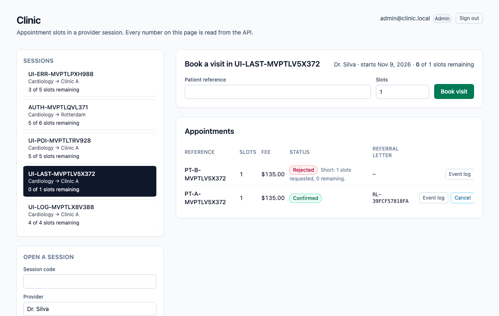
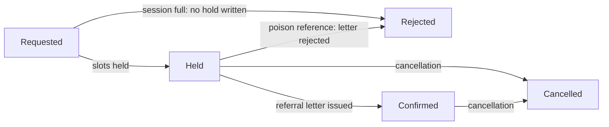
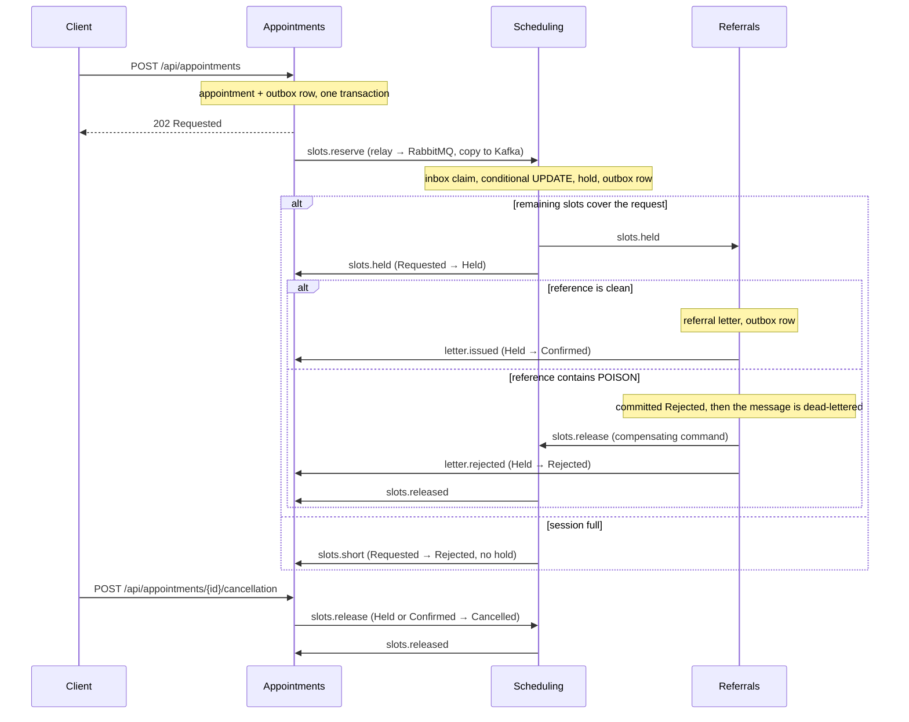

# dotnet-clinic

Appointment slots in a provider session. The scarce number is the **remaining slots** of a session (a provider's morning clinic, say), and the **Scheduling** module is its only writer: it holds slots with a single conditional `UPDATE` that matches only while the remaining slots still cover the request, so when two patients fight for the last slot, one commits a hold and the other is told the session is full and no hold is written. A patient reference that contains the poison token `POISON` is committed as rejected by the Referrals module, the message is dead-lettered, and a compensating command gives the slot back. A later cancellation also gives the slot back, but it does not roll back the referral letter that was already issued.

One ASP.NET Core process, one Postgres database. An HTTP write saves the appointment and an outbox row in one local transaction; a `BackgroundService` relay publishes outbox rows to RabbitMQ (the work queue) and Kafka (the event log); the next module consumes from RabbitMQ, claims an inbox key in the same transaction as its own write, and writes its own row and outbox row. Saga steps never call each other in-process. Delivery is at-least-once: the relay can publish and crash before it marks a row sent, so the row goes out again, and every consumer dedupes with its inbox key. Each saga step only moves an appointment forward from the status it expects.

> The Compose network is local and unauthenticated. There is no login, no token and no cookie. Do not publish these ports; Compose binds all of them to `127.0.0.1`.



*The UI reads everything from the API. Shown: one appointment confirmed, one short, one rejected for the poison token, and one cancellation that gave the slot back and kept its referral letter.*

## Appointment statuses



`Cancelled` and `Rejected` (after a hold) give the slots back through a `ReleaseSlots` command, and Scheduling releases a hold at most once. The referral letter has its own status (`Issued` or `Rejected`) and a cancellation never changes it. If the cancellation gets there before the final mark, the late mark finds the appointment is no longer `Held` and does nothing.

## How the modules talk



| Module | Owns | Consumes | Emits |
| --- | --- | --- | --- |
| **Appointments** (`Modules/Appointments`) | `Appointments`: status, fee, patient reference. Validation, the poison rule, the fee. | `slots.held`, `slots.short`, `letter.issued`, `letter.rejected`, `slots.released` | `slots.reserve`, `slots.release` (cancellation) |
| **Scheduling** (`Modules/Scheduling`) | `Sessions.RemainingSlots` (sole writer after the session opens) and `SlotHolds`. | `slots.reserve`, `slots.release` (prefetch 1) | `slots.held`, `slots.short`, `slots.released` |
| **Referrals** (`Modules/Referrals`) | `ReferralLetters`. | `slots.held` | `letter.issued`, `letter.rejected`, `slots.release` (poison) |
| **Messaging** (`Messaging`) | `OutboxMessages`, `InboxMessages`, the relay, the consumer loop with retry and dead-letter, the Kafka log. | | |

RabbitMQ topology is declared in code (`Messaging/Topology.cs`): exchange `clinic.work`, one queue per module (`scheduling.commands`, `referrals.work`, `appointments.events`), a `.retry` queue per module (2 s TTL, then back to the main queue, 3 attempts), and a `.dlq` per module behind `clinic.dlx`. A transient failure retries; a poison message goes straight to the dead-letter queue after its rejection is committed. Kafka has one topic, `clinic.events`, one partition, replication factor 1, keyed by appointment id.

## Run it

Needs Node 22 (npm 10), .NET SDK 10.0.401 (`global.json`), Docker (arm64 is fine) and python3 for the smoke script.

```bash
npm ci
docker compose up -d --wait db        # dotnet test uses Postgres on 5471 (database clinic_test)
dotnet test tests/api/Clinic.Api.Tests.csproj
docker compose up --build --wait      # db, kafka, rabbitmq, api, web
./scripts/smoke.sh                    # last line: clinic smoke passed
npx playwright install chromium       # once
npx playwright test                   # one spec against http://127.0.0.1:8091
docker compose down                   # keeps the Postgres volume; `down -v` drops it
```

| Service | Host port |
| --- | --- |
| Web (nginx, proxies `/api/`) | 8091 |
| API (`/scalar/v1`, `/api/health`) | 5211 |
| Postgres 17 | 5471 |
| Kafka 3.8.1 (KRaft, one broker) | 9121 |
| RabbitMQ 3.13 / management UI (`platform` / `platform`) | 5701 / 15701 |

Inside the Compose network the API and nginx listen on 8080 and Kafka's internal listener is 9092.

## Try it with curl

```bash
curl -s -X POST http://127.0.0.1:5211/api/sessions \
  -H 'content-type: application/json' \
  -d '{"code":"SILVA-CARD-1","provider":"Dr. Silva","specialty":"Cardiology","location":"Clinic A","capacitySlots":12}'

curl -s -X POST http://127.0.0.1:5211/api/appointments \
  -H 'content-type: application/json' \
  -d '{"sessionCode":"SILVA-CARD-1","reference":"PT-1001","slots":2}'
# 202, status Requested. Use the returned id:

curl -s http://127.0.0.1:5211/api/appointments/<id>          # Confirmed after a few seconds, with a letter number
curl -s http://127.0.0.1:5211/api/letters/<id>
curl -s http://127.0.0.1:5211/api/sessions/SILVA-CARD-1      # remainingSlots 10
curl -s http://127.0.0.1:5211/api/appointments/<id>/events   # the Kafka log for this appointment

curl -s -X POST http://127.0.0.1:5211/api/appointments/<id>/cancellation \
  -H 'content-type: application/json'                        # slots come back; the letter stays
```

An appointment is validated at the door: patient reference required (at most 40 characters), 1 to 4 slots. The fee is 12,000 cents per slot plus a 1,500 cent admin fee. The poison match is a case-sensitive substring: `PT-POISON-7` and any longer token containing `POISON` match.

## What is tested, and where it runs

- **xUnit against real Postgres** (`tests/api`, 25 tests): two tasks with two `DbContext`s fight for one remaining slot (one `Held`, one `Short`, remaining 0, no hold for the loser); empty input, over-limit input, integer overflow (4294967297 must not wrap to 1), the fee, the poison substring; the same message delivered twice is claimed once; a release returns the slot once; the poison rejection is committed before the dead-letter; a cancellation followed by the late final mark leaves the appointment `Cancelled` and the letter `Issued`. The race test was run against a read-then-write version of the hold, where it failed, and against the conditional update, where it passes.
- **`scripts/smoke.sh`** drives the composed stack with a run id on every code, so a kept volume does not collide: validation, the happy path (fee, letter, Kafka log), the last slot with three concurrent appointments (one confirmed, two short, no hold for the losers), the poison reference (rejected, `referrals.work.dlq` gains one message, slots restored), and a cancellation that lands between the letter and the final mark (appointment `Cancelled`, letter `Issued`, slots back, second cancellation `409`). To make that last window wide enough to hit on purpose, Compose sets `Appointments__FinalMarkDelayMs=1500`; it is a latency knob and defaults to 0.
- **Playwright** (`e2e/specs/book-appointment.spec.ts`): opens a session in the UI, books a visit, sees `Confirmed` and the letter number, reloads to prove the page reads the API and keeps nothing in `localStorage`, then cancels and sees the slots come back. It runs against the composed web port, on a developer machine.
- **CI** (`.github/workflows/ci.yml`, on push): `npm ci`, Prettier check, `dotnet format whitespace --verify-no-changes`, `dotnet test` with a Postgres 17 service, and `nx build` for web and api. CI does not run the compose smoke or the Playwright spec.

## Cloud mapping

This repository runs on Compose. Nothing in it calls a cloud account.

| Here | On Azure |
| --- | --- |
| Postgres 17 | Azure Database for PostgreSQL |
| Kafka 3.8 | Event Hubs |
| RabbitMQ 3.13 | Service Bus queue with its dead-letter sub-queue |
| The API and the web app | Container Apps |

## API

All routes are unauthenticated JSON. Interactive docs are at `http://127.0.0.1:5211/scalar/v1` (OpenAPI at `/openapi/v1.json`); the web port proxies `/api/`, `/scalar/` and `/openapi/` too.

| Method and path | What it does | Responses |
| --- | --- | --- |
| `GET /api/health` | Liveness. | `200 Healthy` |
| `POST /api/sessions` | Opens a session with its starting count. | `201`, `400` invalid, `409` code exists |
| `GET /api/sessions` | Lists sessions. | `200` |
| `GET /api/sessions/{code}` | One session with the live remaining count. | `200`, `404` |
| `POST /api/appointments` | Accepts a appointment (1 to 4 slots) and starts the saga. | `202` Requested, `400` invalid, `404` unknown session, `409` duplicate reference |
| `GET /api/appointments?sessionCode=` | Lists the latest 100 appointments, optionally for one session. | `200` |
| `GET /api/appointments/{id}` | One appointment and its status. | `200`, `404` |
| `POST /api/appointments/{id}/cancellation` | Moves a held or confirmed appointment to its cancellation status and gives the slot back. The referral letter is not touched. | `202`, `404`, `409` wrong status |
| `GET /api/appointments/{id}/events` | The Kafka event log for one appointment, read from the start of the topic. | `200` |
| `GET /api/letters/{appointmentId}` | The referral letter row. | `200`, `404` until the step has run |

Errors come back as `application/problem+json` with a `title`.

## Configuration

Compose sets these on the API container. Defaults in `apps/api/appsettings.json` point at the published host ports, so `nx serve api` works against `docker compose up -d --wait db kafka rabbitmq`.

| Setting | Compose value | Meaning |
| --- | --- | --- |
| `ConnectionStrings__Clinic` | `Host=db;Port=5432;Database=clinic;Username=clinic;Password=clinic` | The one Postgres database. Migrations run on startup. |
| `RabbitMq__Host` / `__Port` / `__User` / `__Password` | `rabbitmq` / `5672` / `platform` / `platform` | Work queue. Virtual host `/`. |
| `Kafka__BootstrapServers` | `kafka:9092` | Event log. |
| `Appointments__FinalMarkDelayMs` | `1500` | Milliseconds the final mark waits. A latency knob so the smoke can land a cancellation inside the window. `0` outside Compose. |
| `CLINIC_TEST_DB` (tests only) | | Postgres connection for `dotnet test`. Defaults to `localhost:5471`, database `clinic_test`. CI points it at its service container. |

## Look inside and fix things

```bash
docker compose ps                      # five services, all healthy
docker compose logs -f api             # relay, consumers, poison and retry lines
docker compose exec db psql -U clinic -d clinic -c 'select "RoutingKey","SentAt" from "OutboxMessages" order by "Id" desc limit 10'
open http://127.0.0.1:15701        # RabbitMQ management, platform / platform
```

- **Dead-lettered messages** sit in `referrals.work.dlq`. Nothing replays them; inspect them in the management UI. Retries wait in `<queue>.retry` for 2 seconds.
- **A port is already in use**: `lsof -nP -i :5211` shows who holds it. Compose publishes only on `127.0.0.1`.
- **`dotnet test` cannot connect**: start Postgres first with `docker compose up -d --wait db`.
- **The smoke cannot reach the API**: run `docker compose up --build --wait` first; override the target with `API=... RABBIT=... ./scripts/smoke.sh`.
- **Start clean**: `docker compose down -v` drops Postgres, Kafka and RabbitMQ data. Plain `down` keeps them, and the smoke is safe on kept data because every code carries a run id.
- **The Kafka log looks empty right after a booking**: the relay publishes within a second or so; reload the event log.

## Known limits

- It is unauthenticated on purpose. Anything that can reach the API can read and write everything.
- Delivery is at-least-once, not exactly-once. The inbox makes repeats harmless for the saga; the Kafka log can hold a duplicate event after a relay crash.
- One broker, one partition, replication factor 1, one API instance. The relay does not coordinate across instances (the inbox would absorb the duplicates, but the outbox is never trimmed).
- `GET .../events` scans the whole topic for each call. Fine here, not something to expose at scale.
- Lists are capped at 100 rows and not paginated.
- Dead-lettered messages are not replayed automatically.
- The browser spec and the compose smoke run on a developer machine; CI does not run them.

## Layout

```
apps/api      ASP.NET Core monolith: Modules/{Appointments,Scheduling,Referrals}, Messaging, Data, Migrations
apps/web      Angular 21, styled with Tailwind 4 utilities only
tests/api     xUnit against Postgres
e2e/          Playwright
scripts/      smoke.sh
compose.yaml  Postgres, Kafka, RabbitMQ, API, web
```

Nx 23.2.1 orchestrates `nx build web` and `nx build api`; EF Core migrations are committed and the API applies them on startup.

## Other systems in this .NET track

- [dotnet-freight](https://github.com/joshbarros/dotnet-freight): container space on ocean sailings.
- [dotnet-ledger](https://github.com/joshbarros/dotnet-ledger): outgoing payments from an account balance.
- [dotnet-warehouse](https://github.com/joshbarros/dotnet-warehouse): warehouse stock and outbound orders.
